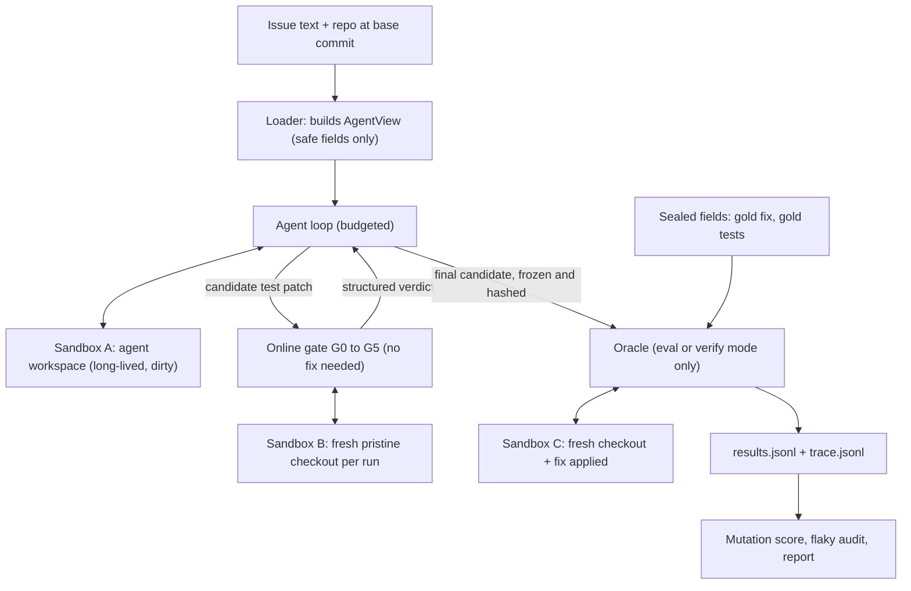

# Repro: Design

Status: planning complete (2026-11-16). No implementation code yet.
Companion docs: [MILESTONES.md](MILESTONES.md), [TEST_SPEC.md](TEST_SPEC.md), [EVAL_AND_METRICS.md](EVAL_AND_METRICS.md), [RISKS.md](RISKS.md).

## 1. What Repro is

Repro takes a bug report (a GitHub issue) and a repository, and writes a test that:

1. fails on the buggy code, for the reason the issue describes, and
2. passes once the real fix is applied.

It automates the test-first habit: before touching a fix, pin the bug down with a failing test.

One sentence for interviews: "Repro is a small agent plus a verification harness that turns a bug report into a failing test you can trust, and I can tell you exactly how often it is right and what each one costs."

### What it is not

- It does not fix bugs.
- It is Python-only (pytest and the test runners SWE-bench already supports).
- It is not trying to top a leaderboard. General coding agents already score about 76 to 88% on SWT-bench Verified (see EVAL_AND_METRICS.md section 7). Repro's value is a harness I fully understand, with measured trust properties the leaderboard does not report: cost per bug, how often "reproduced" is actually true, flaky rate, and test strength.

## 2. Product layer

| Question | Answer |
|---|---|
| Target user | Teams of 2 to 10 engineers with no QA function and a Python backend. Bug reports arrive as loosely written issues. |
| Problem | The first 30 to 60 minutes of most bug fixes is spent reproducing the bug. Without a failing test, fixes ship unverified and regress later. |
| Job to be done | "When a bug report comes in, give me a failing test I can trust before I start fixing." |
| Origin | My own workflow at a fintech backend internship: write the failing test first, then fix. |
| Why a tool and not just a chat prompt | A prompt gives you a test. It does not tell you whether the test fails for the right reason, whether it is flaky, or what it cost. The harness around the model is the product. |
| v1 (this repo) | CLI plus eval harness. |
| v2 (designed, not built) | GitHub App that comments a failing test on new issues. A GitHub Action version is the stretch milestone M11. |

### Product metrics

| Metric | Why it matters | Proxy measured in this project |
|---|---|---|
| North star: reproductions accepted (test merged) per week | Only merged tests create value | Success rate S on SWT-bench Verified |
| Guardrail: precision of "reproduced" claims | A bot that posts wrong tests gets uninstalled after the second one | Gate precision (EVAL H3) |
| Guardrail: cost per issue | Must be far below the engineer time it replaces | Cost per bug (EVAL H2) |
| Guardrail: flaky tests shipped | A flaky test in CI is worse than no test | Flaky rate (EVAL H4) |
| Quality: does the test pin the behaviour or just one input | Weak tests pass after a wrong fix | Mutation score vs human-written tests (EVAL H5) |

### Product tradeoffs I chose

- **Abstain instead of guessing.** In product mode Repro posts nothing unless the gate passes. This costs recall and buys precision. The eval measures both sides of that trade (S always-emit vs S gated).
- **Cheap model first.** Default is a small model with a hard per-bug ceiling. A frontier model is an ablation, not the default, because the user is cost-sensitive.
- **Unit-test mode, not standalone scripts.** The output is a test in the project's own test framework that can be committed. Standalone reproduction scripts are easier to generate (leaderboard entries that use them are marked separately) but are not what a team merges.
- **Environment setup is the adoption barrier, and I do not solve it in v1.** On SWE-bench someone has already built a Docker image per bug. On a real repo the user must give Repro an image and a test command (`.repro.yml`). v2 would reuse the repo's existing CI container.

## 3. Constraints that shape the design

These were checked on 2026-11-16, not assumed.

1. **Build sessions happen in Claude chat.** That workspace has Python and pip, but no Docker daemon, and cannot reach Docker Hub, GHCR, or Hugging Face. So everything must be buildable and testable without Docker, without real LLM calls, and without SWE-bench data.
2. **Real runs happen on an "eval box"**: an x86_64 Linux machine with Docker. The SWT-bench harness asks for about 120 GB free disk, 16 GB RAM, 8 cores. Default plan is a rented cloud VM for the eval window.
3. **Money is real.** LLM spend is hard-capped (section 8).
4. **The fix does not exist at product time.** The issue arrives before the fix. So "fail before, pass after" splits into two halves (section 6): a gate that needs no fix, and an oracle that does.

Consequence: every external dependency sits behind an interface with a fake.

| Dependency | Interface | Real | Fake used in chat sessions |
|---|---|---|---|
| Code execution | `Sandbox` | `DockerSandbox` | `LocalSandbox` (subprocess + rlimits, fixture repos only) |
| Model | `LLMClient` | `AnthropicClient` | `FakeLLM` (scripted) and `CassetteLLM` (record/replay) |
| Benchmark data | `InstanceSource` | `SWTBenchSource` | `FixtureSource` (toy repos committed in `tests/fixtures/`) |

## 4. Architecture



Key property: the agent can do anything it likes in Sandbox A. None of it counts. Only a diff of test files leaves Sandbox A, and it is re-applied to a clean checkout the agent has never touched. The oracle result never flows back to the agent in eval mode.

### 4.1 Planned layout

```
src/repro/
  models.py          Instance, AgentView, SealedView, Candidate, TestOutcome,
                     GateVerdict, OracleVerdict, RunResult, Budget
  cli.py             repro run | verify | eval | audit | mutate | report | show
  config.py          typed config, config hash
  datasets/          fixtures.py, swtbench.py, samples.py
  sandbox/           base.py (protocol), local.py, docker.py, limits.py
  runner/            test command building, outcome parsing (JUnit XML, swebench log parsers)
  gate/              scope.py (G0), checks.py (G1 to G5), signature.py, judge.py
  oracle/            oracle.py
  llm/               client.py (protocol), anthropic_client.py, fake.py, cassette.py,
                     pricing.py, ledger.py
  agent/             loop.py, tools.py, prompts.py, stops.py, context.py
  baseline/          retrieval.py (BM25), single_prompt.py (B0), pass_at_k.py (B1)
  mutation/          operators.py, generate.py, score.py
  eval/              run.py, export.py, audit.py, metrics.py, report.py
tests/
  unit/  contract/  adversarial/  e2e/  fixtures/mini_repos/
eval/
  configs/  samples/  results/  cassettes/
```

Host package targets Python 3.11+. Code inside benchmark containers runs on whatever old Python that repo needs (3.6 to 3.9 is common), so anything Repro injects into a container must be stdlib-only and old-syntax safe.

## 5. Components

### 5.1 Instance and data separation

```
Instance
  public: AgentView     instance_id, repo, base_commit, issue_text, test_cmd_spec
  sealed: SealedView    gold_fix_patch, gold_test_patch, fail_to_pass, pass_to_pass, hints_text
```

- The agent, the baselines, the prompts, and the gate only ever receive `AgentView`. This is enforced by types (functions take `AgentView`, not `Instance`) and by a canary test that scans every prompt and trace for sealed content.
- `hints_text` (later issue comments) is sealed too. It can contain the fix discussion.
- Only the oracle, mutation scorer, and audit receive `SealedView`.

### 5.2 Sandbox

Protocol: `start()`, `exec(cmd, timeout_s) -> ExecResult`, `put_file`, `get_file`, `apply_patch`, `source_tree_hash()`, `close()`. One sandbox object is one container (or one temp dir for `LocalSandbox`).

`DockerSandbox` settings:

| Setting | Value | Why |
|---|---|---|
| Network | `--network none` | No fetching the fix, no exfiltration, removes a flakiness source |
| Memory | `--memory 4g --memory-swap 4g` | Kill runaway tests, no swap thrash |
| CPU | `--cpus 2` | Fair sharing across 4 workers on 8 cores |
| PIDs | `--pids-limit 512` | Fork bombs |
| Privileges | `--cap-drop ALL --security-opt no-new-privileges` | Shrink attack surface |
| Mounts | none from host, no Docker socket | The container cannot see the host or the API key |
| Lifetime | new container per verification run, removed after | No state carries between runs |
| Per-command timeout | 60 s shell, 180 s test run | In-container `timeout -s KILL` plus a host watchdog that kills the container |
| Per-instance wall clock | 20 min | Hard stop |
| Output cap | 16 KB per command, head and tail kept | Protects the context budget |
| Cleanup | every container labelled `repro.run_id`; a reaper removes leftovers at start and exit | No leaked containers after a crash |

Implementation choice: drive the `docker` CLI through `subprocess` instead of the Docker SDK. Fewer dependencies, and every action is a command I can copy and rerun by hand when debugging. Cost: I parse CLI output and manage timeouts myself.

Threat model: the repo's code and the model's commands are untrusted. Docker with the settings above is the boundary. This does not defend against container-escape kernel bugs. That is acceptable for benchmark repos on a throwaway VM. A public GitHub App running strangers' code would need gVisor or Firecracker (RISKS R10).

Leakage hardening at container start (before the agent's first step):
- Replace `.git` with a fresh single-commit repo at the base commit, so no future commit containing the fix is reachable.
- Confirm no network.
- The LLM API key lives on the host only. LLM calls are made by the host process, never from inside a container.

`LocalSandbox` runs fixture repos in a temp dir with `resource.setrlimit` and a process-group kill on timeout. It exists so the whole pipeline is testable in chat. It is never used on untrusted code.

### 5.3 Test runner and outcome parsing

- Input: a list of test files or node ids. Output: `{test_id: PASSED | FAILED | ERROR | SKIPPED | XFAIL | XPASS}` plus failure details.
- pytest repos: JUnit XML (`--junitxml`) plus `-p no:cacheprovider -p no:randomly`.
- Non-pytest repos (Django's `runtests.py`, sympy's `bin/test`): reuse the per-repo test commands and log parsers from the `swebench` package. I do not write my own parsers for these.
- Only `FAILED` in the call phase counts as "fails". `ERROR` (collection, setup, import), `SKIPPED`, `XFAIL`, and timeouts never count as a failing reproduction.

### 5.4 The verification gate (the core of the project)

A **candidate** is a diff plus the test ids it adds. The gate has two halves.

**Online gate: no fix needed. This is all the product has at issue time.**

| Check | Rule | Catches |
|---|---|---|
| G0 Scope | Diff touches only test paths. Additions only (new files, or lines appended to existing test files). No edits to `conftest.py`, config files, or source. No skip or xfail markers. | Editing source, weakening existing tests, disabling tests |
| G1 Collects | New tests are collected and executed on a pristine buggy checkout | Syntax errors, bad imports, wrong location |
| G2 Fails before | At least one new test is `FAILED` in the call phase on buggy code | Tests that pass on the bug, errors posing as failures |
| G3 Right reason | The failure is an `AssertionError` raised by the test, or an exception whose traceback passes through repo source frames. Failures that originate purely in test code (`NameError`, `TypeError` from misuse, missing fixture) are rejected. Optional LLM judge compares the failure to the issue's symptom (ablation, off by default). | Tests that fail because the test itself is broken |
| G4 Stable | 3 runs in 3 fresh sandboxes with `PYTHONHASHSEED` 0, 1, 2. All 3 must fail with the same failure signature. | Flaky tests |
| G5 Exercises the code | A stdlib tracer plugin confirms that, during the test's call phase, at least one line inside a function body of non-test repo source runs (import-time lines do not count). Source tree hash is unchanged after the run. | `assert False`, tests that never call the code, tests that rewrite source at runtime |

Failure signature = (exception type, message with numbers, addresses and paths masked, innermost repo frame).

**Oracle: needs the fix. Used in eval, and in the product only once a fix exists (`repro verify --fix`).**

| Check | Rule |
|---|---|
| O1 Pass after | Fresh checkout, apply fix, apply candidate. New tests pass in 3 of 3 runs. |
| O2 No collateral | No test in the touched files fails after the fix. This mirrors the SWT-bench success definition. |

Per-test transitions are recorded (F→P, F→F, P→P, P→F, E→x). An instance is REPRODUCED when there is at least one F→P and no x→F.

**Why it cannot fake success**

1. Verification never runs in the agent's workspace. Only a test-file diff is carried to a clean checkout.
2. The diff is additions-only and test-paths-only, so source and existing tests cannot be changed.
3. The agent never declares success. `submit` is a request; the harness decides.
4. In eval, the final candidate is frozen and its SHA-256 written to the trace before the oracle runs. The oracle result is never shown to the agent.
5. Skip, xfail, error, and timeout are not "fail". Only a call-phase failure is.

**What the online gate cannot catch, stated plainly:** a test that fails on the bug for a plausible reason but asserts the wrong expected behaviour will still fail after the fix (F→F). Only the oracle sees that. This is exactly what gate precision (EVAL H3) measures. It is a number I report, not a hole I hide.

### 5.5 LLM layer and budget

- `LLMClient.complete(messages, tools, max_tokens) -> Response` with token usage. One real implementation (Anthropic). The protocol keeps other providers possible without building them.
- `pricing.yaml` pins price per model with a `verified_on` date. Prices as reported in Nov 2026: Haiku 5.5 at $0.10 in / $0.50 out per million tokens for prompts up to 100K tokens, 5x above that; Sonnet 5.5 at $2 / $10. These get re-checked against Anthropic's pricing page in M3 before any paid run.
- **Ledger.** Append-only JSONL with a file lock. Every call records tokens and cost.
- **Ceilings are pre-emptive.** Before each call: `spent + worst_case(prompt_tokens, max_tokens) <= ceiling`, else refuse. So a ceiling is never exceeded, as opposed to "stop after going over". Same check at run level (the global cap).
- **Context cap of 90K prompt tokens** to stay under Haiku 5.5's 100K price tier. Enforced by truncating tool outputs and dropping the oldest tool results first. The issue text and the latest gate verdict are never dropped.
- **Cassettes.** `CassetteLLM` records real responses keyed by request hash and replays them. Traces recorded on the eval box can be replayed in a chat session with no API access, which is how failures get debugged later.

### 5.6 Agent loop

One model, one loop, six tools. No multi-agent setup.

| Tool | What it does |
|---|---|
| `bash(cmd)` | Shell in Sandbox A (no network, timeouts, output cap) |
| `view(path, start, end)` | Read a file slice with line numbers |
| `write_test(path, content, mode)` | Create a new test file or append to an existing one. Test paths only. |
| `check(test_ids)` | Run the online gate on the current candidate. Returns a structured verdict, including which G-check failed and the failure signature. |
| `submit()` | Ask to finish with the current candidate |
| `abstain(reason)` | Give up explicitly |

Why a shell and not a fixed list of narrow tools: the sandbox is the security boundary, and the gate is independent of the workspace, so a shell costs nothing in safety and lets the agent do what an engineer does (grep, run a snippet, read existing tests).

Intended flow (prompted, not hard-coded): locate the code and the nearest existing tests, reproduce the symptom in a quick snippet, write the test in the project's style, `check`, refine, `submit`.

**Stop conditions (defaults for the Haiku config):**

| Limit | Default |
|---|---|
| Steps | 30 |
| Cost per bug | $0.25 |
| Wall clock per bug | 20 min |
| Gate checks | 8 |
| Prompt tokens per call | 90,000 |
| Output tokens per call | 4,000 |
| Consecutive tool errors | 5 |
| Same action repeated | 3 (one nudge, then stop) |
| Run-level LLM spend | $80 |

**Terminal states:** `SUBMITTED` (gate passed), `ABSTAINED(reason)`, `BUDGET_EXHAUSTED(kind)`, `INFRA_ERROR`.

On any stop, the loop keeps the best candidate so far (gate passed beats gate failed beats none). One run therefore yields both eval modes at no extra cost:
- **gated**: emit the test only if the gate passed (product behaviour)
- **always-emit**: emit the best candidate regardless (what SWT-bench scores)

### 5.7 Baselines

- **B0, single prompt.** One call. Issue text plus BM25-retrieved files (about 27K tokens of context, mirroring the published Zero-Shot Plus setup). No execution. Output is a test file or an append block; the harness turns it into a diff.
- **B1, pass@5 with gate.** Five independent single-prompt samples; emit the first that passes the online gate. This separates "the gate helps" from "the agent loop helps".

### 5.8 Mutation scorer

Purpose: fail-before/pass-after shows the test catches this bug. Mutation score shows whether it pins the fixed behaviour or just one input.

- Mutate the **fixed** code, only on lines the fix changed (expanded to the enclosing statement; to the enclosing function if fewer than 3 mutants result). Capped at 30 mutants per instance, seeded sampling.
- Six operators: comparison swap, boolean swap, condition negation, arithmetic swap, constant change, statement deletion.
- Mutants are generated on the host (modern Python, format-preserving) and executed in the sandbox.
- Killed = any generated test fails, errors, or times out. Score = killed / valid mutants.
- Reference: the human-written gold tests scored on the **same** mutants. Reporting the paired difference cancels out equivalent mutants, which I cannot detect automatically.
- Needs the fix, so it is an eval-time metric only.

### 5.9 Eval runner and report

- Work unit = (instance, config). Results are keyed on that pair, so a killed run resumes without redoing or re-paying for finished work.
- 4 workers by default. The global ledger cap applies across workers.
- Exports predictions in SWT-bench format (`instance_id`, `model_name_or_path`, `model_patch`) so the official harness produces the headline S.
- `repro report` builds the README results table and plots from `results.jsonl` only. No hand-typed numbers.

### 5.10 CLI

```
repro run     --repo PATH --issue FILE_OR_URL [--config ...]   reproduce mode, no fix needed
repro verify  --run RUN_ID --fix PATCH                         oracle on an existing run
repro eval    --config eval/configs/main.yaml                  benchmark run, resumable
repro audit   --run RUN_ID                                     10x flaky audit
repro mutate  --run RUN_ID                                     mutation scores
repro report  --run RUN_ID                                     tables and plots
repro show    RUN_ID INSTANCE_ID                               readable trace timeline (used in the demo)
repro fixtures check                                           gold tests fail-before/pass-after on the toy repos
```

## 6. Data flow for one bug

1. Loader builds `AgentView`. Sealed fields stay in the eval process.
2. Sandbox A starts from the instance image. `.git` is replaced, network is off.
3. Agent loop runs. Each `check` spins up fresh pristine sandboxes and returns a verdict.
4. Loop ends in a terminal state. Final candidate (if any) is frozen and hashed into the trace.
5. Eval only: the oracle applies the gold fix in a fresh sandbox and runs the candidate 3 times.
6. One row is appended to `results.jsonl`. The full event stream is in `traces/<instance>.jsonl`.
7. Later passes over frozen candidates: flaky audit (10x), mutation score, official SWT-bench harness.

`results.jsonl` row (one per instance per config): `instance_id, config_id, config_hash, model_id, terminal_state, stop_reason, candidate_sha256, gate{g0..g5}, oracle{transitions, reproduced}, steps, gate_checks, tokens_in, tokens_out, cost_usd, wall_clock_s, infra_error`.

Trace event: `ts, run_id, instance_id, seq, type (llm_call | tool_call | gate_check | stop | oracle), payload, cost_usd`.

## 7. Key decisions and tradeoffs

| # | Decision | Alternative | Why this way | Cost accepted |
|---|---|---|---|---|
| D1 | Split verification into online gate + oracle | Single fail-before/pass-after check | The fix does not exist at product time. Splitting makes the product claim honest and creates the gate-precision metric. | More to build and explain |
| D2 | Verify on a pristine checkout from a test-only diff | Verify in the agent's workspace | Removes every "it worked in my workspace" way to fake success | A few extra container starts per check |
| D3 | Additions-only diffs | Allow edits to existing tests | Simple rule, checkable with a diff parser, cannot weaken existing tests | Cannot fix a wrong existing test (rare, out of scope) |
| D4 | Shell tool inside the sandbox | Narrow tool list only | Sandbox is the boundary; shell matches how bugs get investigated | Harder to predict agent behaviour; handled by budgets |
| D5 | Pre-emptive budget ceilings | Check after each call | A ceiling you can overshoot is not a ceiling | Slightly conservative; may stop one call early |
| D6 | Small model as default, frontier as ablation | Best model everywhere | Cost per bug is a headline number and the user is cost-sensitive | Lower raw S than the leaderboard top |
| D7 | Official SWT-bench harness for headline S, own harness for everything else | Own harness only | Published numbers are only comparable through their harness. Agreement between the two is itself a reported check. | Two harnesses to keep in step |
| D8 | SWT-bench Verified, pre-registered sample of 150 | Full 433, or Lite | Verified has the current published results. 150 keeps cost bounded with a CI of about plus or minus 8 points. | Not a leaderboard entry; wider CI |
| D9 | Unit-test mode | Reproduction-script mode | The product output is a committable test | Harder; lower S than script mode |
| D10 | 3 reruns in the loop, 10 in the audit | 10 everywhere | In-loop reruns cost wall clock on every check. 3 catches gross flakiness; the 10x audit measures what slipped through. | 3 runs miss low-rate flakes (see EVAL H4 power table) |
| D11 | Mutants only on fix-changed lines, compared against gold tests | Whole-file mutation, raw score | Tractable, and the paired comparison cancels equivalent mutants | Score says nothing about code outside the fix |
| D12 | Reuse `swebench` test specs and log parsers | Write my own | Django alone is a large share of Verified and does not use pytest | A dependency I do not control |
| D13 | Fakes behind interfaces, cassettes for the LLM | Build on the eval box only | Build sessions run where there is no Docker and no dataset access | Fakes can drift from real behaviour; contract tests run on both |
| D14 | JSONL files, no database | SQLite or Postgres | One writer per file, append-only, diffable, loads straight into pandas | No ad hoc SQL without loading first |
| D15 | `docker` CLI via subprocess | Docker SDK for Python | Fewer deps, every action is a reproducible command | Manual timeout and output handling |

## 8. Cost plan (estimates made before any measurement)

| Item | Estimate |
|---|---|
| Agent on Haiku 5.5, per bug | about $0.08 (ceiling $0.25) |
| Main run: 150 bugs, agent + B0 + B1 | about $15 |
| Dev iteration on 30 bugs | about $15 |
| Sonnet 5.5 ablation on 50 bugs | about $25 (ceiling $2 per bug) |
| Variance reruns, judge ablation, slack | about $15 |
| **LLM total** | **about $70, hard cap $80** |
| Eval VM (8 vCPU, 32 GB, 250 GB, about 40 hours) | about $12 |
| **Project total** | **about $80 to $85, never above $100** |

These are planning numbers. The measured figures replace them in the README.

## 9. v2: GitHub App (design only)

- Trigger: `issues.opened` with a `bug` label.
- Flow: clone at default branch, read `.repro.yml` (image or Dockerfile, test command, test paths, monthly budget), run reproduce mode, and if the gate passes, comment the test with the failure output and a one-line command to run it. If the gate fails, stay silent.
- When a PR that references the issue opens: run the oracle with the PR's diff as the fix and comment whether the Repro test now passes.
- New problems v2 would have to solve: stronger isolation than Docker for untrusted repos, prompt injection through issue text (the bot must treat issue text as data), per-installation budgets, and environment setup without a prebuilt image.
- M11 (stretch) ships the cheap version of this: a GitHub Action that runs inside the repo's own CI environment, which sidesteps the isolation and environment problems.

## 10. Open items to settle in the first sessions

- Image source for the sandbox: reuse images built by the SWT-bench harness (preferred, same environment as the scorer) or pull prebuilt SWE-bench images. Decided in eval-box task E0.
- Whether Haiku 5.5 clears the floor on the dev set. Decision rule is in EVAL_AND_METRICS.md section 5.
- Exact SWT-bench CLI flags for the Verified split. Confirmed from their README in E0.
