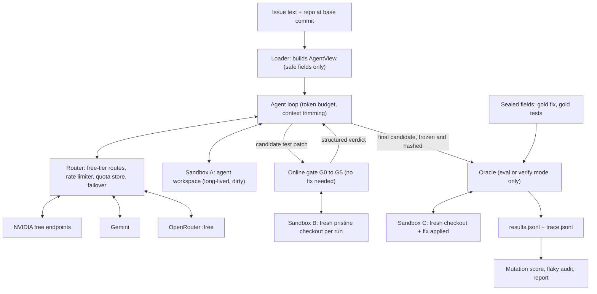

# Repro: Design

Status: planning complete. Revision 2 (2026-11-17): the project now runs at $0. It uses free LLM API tiers behind one router and free GitHub Actions compute. No implementation code yet.
Companion docs: [MILESTONES.md](MILESTONES.md), [TEST_SPEC.md](TEST_SPEC.md), [EVAL_AND_METRICS.md](EVAL_AND_METRICS.md), [RISKS.md](RISKS.md).

## 1. What Repro is

Repro takes a bug report (a GitHub issue) and a repository, and writes a test that:

1. fails on the buggy code, for the reason the issue describes, and
2. passes once the real fix is applied.

It automates the test-first habit: before touching a fix, pin the bug down with a failing test.

One sentence for interviews: "Repro is a small agent plus a verification harness that turns a bug report into a failing test you can trust. It runs entirely on free model tiers, and I can tell you exactly how often it is right and how many tokens each test takes."

### What it is not

- It does not fix bugs.
- It is Python-only (pytest and the test runners SWE-bench already supports).
- It is not trying to top a leaderboard. Frontier coding agents already score about 76 to 92% on SWT-bench Verified (EVAL_AND_METRICS.md section 7). Repro runs on free-tier models, so its raw score will be lower. Its value is a harness I fully understand, with measured trust properties the leaderboard does not report: how often "reproduced" is actually true, tokens per bug, flaky rate, and test strength.

## 2. Product layer

| Question | Answer |
|---|---|
| Target user | Teams of 2 to 10 engineers with no QA function and a Python backend. Bug reports arrive as loosely written issues. |
| Problem | The first 30 to 60 minutes of most bug fixes is spent reproducing the bug. Without a failing test, fixes ship unverified and regress later. |
| Job to be done | "When a bug report comes in, give me a failing test I can trust before I start fixing." |
| Origin | My own workflow at a fintech backend internship: write the failing test first, then fix. |
| Why a tool and not just a chat prompt | A prompt gives you a test. It does not tell you whether the test fails for the right reason, whether it is flaky, or what it cost. The harness around the model is the product. |
| v1 (this repo) | CLI plus eval harness. |
| v2 (designed, not built) | GitHub App that comments a failing test on new issues. A GitHub Action version is the stretch milestone M11. |

### Product metrics

| Metric | Why it matters | Proxy measured in this project |
|---|---|---|
| North star: reproductions accepted (test merged) per week | Only merged tests create value | Success rate S on SWT-bench Verified |
| Guardrail: precision of "reproduced" claims | A bot that posts wrong tests gets uninstalled after the second one | Gate precision (EVAL H3) |
| Guardrail: compute per issue | Must be far below the engineer time it replaces | Tokens and requests per bug, plus what that would cost at paid list prices (EVAL H2) |
| Guardrail: flaky tests shipped | A flaky test in CI is worse than no test | Flaky rate (EVAL H4) |
| Quality: does the test pin the behaviour or just one input | Weak tests pass after a wrong fix | Mutation score vs human-written tests (EVAL H5) |

### Product tradeoffs I chose

- **Abstain instead of guessing.** In product mode Repro posts nothing unless the gate passes. This costs recall and buys precision. The eval measures both sides of that trade (S always-emit vs S gated).
- **Free open-weights-class model, not a frontier model.** The budget is $0, so the agent runs on free tiers. This is also a product argument: if the harness gets trustworthy tests out of a free model, a team can run it without a model bill. If they want a higher hit rate, a stronger model slots in through the same router.
- **Free tiers are for public code only.** The free tiers used here may train on prompts (section 5.5). That is fine for open-source benchmark repos. It is not fine for a customer's private code, so product mode on private repos needs a paid no-training tier or a self-hosted open model. The router makes that a config change, not a rewrite.
- **Unit-test mode, not standalone scripts.** The output is a test in the project's own test framework that can be committed. Standalone reproduction scripts are easier to generate (leaderboard entries that use them are marked separately) but are not what a team merges.
- **Environment setup is the adoption barrier, and I do not solve it in v1.** On SWE-bench someone has already built a Docker image per bug. On a real repo the user must give Repro an image and a test command (`.repro.yml`). v2 would reuse the repo's existing CI container.

## 3. Constraints that shape the design

Checked on 2026-11-16 and 2026-11-17, not assumed.

1. **Budget is $0 beyond a Claude subscription.** No paid model API, no paid VM. Every paid dependency in revision 1 was swapped for a free one:

   | Need | Revision 1 | Revision 2 |
   |---|---|---|
   | Model | Anthropic API, about $70 | Free tiers (NVIDIA's free endpoints, Gemini, OpenRouter) behind one router |
   | Eval compute | Rented VM, about $12 | GitHub Actions standard runners (free and unlimited on public repos) |
   | Image pulls | n/a | Free Docker Hub account (higher anonymous pull limits) |

2. **Free tiers are rate-limited, unstable, and change without notice.** Limits differ per provider and per model. Some are daily, one is monthly, and they reset at different times. Some are not even published. The design treats limits as data loaded from config and observed at runtime, never as constants in code.
3. **Build sessions happen in Claude chat.** That workspace has Python and pip but no Docker daemon. It cannot reach Docker Hub, GHCR, or Hugging Face, and probably cannot reach the model APIs either. So everything must be buildable and testable without Docker, real model calls, or SWE-bench data.
4. **Real runs happen in GitHub Actions.** Public repos get free, unlimited standard runners: 4 vCPU, 16 GB RAM, 14 GB SSD, 6 hours per job, up to 20 concurrent jobs. A chat session can trigger them through the GitHub REST API and read results back from the repo. Running the same commands on my own machine overnight is the fallback.
5. **The fix does not exist at product time.** The issue arrives before the fix. So "fail before, pass after" splits into two halves (section 5.4): a gate that needs no fix, and an oracle that does.

Consequence: every external dependency sits behind an interface with a fake.

| Dependency | Interface | Real | Fake used in chat sessions |
|---|---|---|---|
| Code execution | `Sandbox` | `DockerSandbox` | `LocalSandbox` (subprocess + rlimits, fixture repos only) |
| Model | `ChatModel` (via `Router`) | `OpenAICompatClient` per route | `FakeLLM` (scripted), `CassetteLLM` (record/replay), `FakeProvider` (simulates 429s, quotas, outages) |
| Benchmark data | `InstanceSource` | `SWTBenchSource` | `FixtureSource` (toy repos committed in `tests/fixtures/`) |
| Time | `Clock` | system clock | `FakeClock` (rate-limit waits and quota resets without sleeping) |

## 4. Architecture



Key property: the agent can do anything it likes in Sandbox A. None of it counts. Only a diff of test files leaves Sandbox A, and it is re-applied to a clean checkout the agent has never touched. The oracle result never flows back to the agent in eval mode.

### 4.1 Planned layout

```
src/repro/
  models.py          Instance, AgentView, SealedView, Candidate, TestOutcome,
                     GateVerdict, OracleVerdict, RunResult, TokenBudget
  cli.py             repro run | verify | eval | status | audit | mutate | report | show | fixtures | llm
  config.py          typed config, config hash
  datasets/          fixtures.py, swtbench.py, samples.py
  sandbox/           base.py (protocol), local.py, docker.py, limits.py
  runner/            test command building, outcome parsing (JUnit XML, swebench log parsers)
  gate/              scope.py (G0), checks.py (G1 to G5), signature.py, judge.py
  oracle/            oracle.py
  llm/               client.py (OpenAICompatClient), registry.py (routes, logical models),
                     router.py (failover policies), limiter.py (token buckets),
                     quota.py (persisted daily/monthly counters), errors.py (classifier),
                     tokens.py (estimator + correction), budget.py (token ledger),
                     fake.py, cassette.py, list_prices.yaml
  agent/             loop.py, protocol.py (text action format), tools.py, prompts.py,
                     stops.py, context.py (trimming + state card)
  baseline/          retrieval.py (BM25), single_prompt.py (B0), pass_at_k.py (B1)
  mutation/          operators.py, generate.py, score.py
  eval/              run.py (batches, shards, deferral), export.py, audit.py, metrics.py, report.py
config/
  routes.yaml        providers, base URLs, models, published limits, reset rules
tests/
  unit/  contract/  adversarial/  e2e/  fixtures/mini_repos/
eval/
  configs/  samples/  cassettes/
.github/workflows/
  ci.yml  bootstrap.yml  live-smoke.yml  docker-tests.yml  eval.yml  official-score.yml
```

Host package targets Python 3.11+. Code inside benchmark containers runs on whatever old Python that repo needs (3.6 to 3.9 is common), so anything Repro injects into a container must be stdlib-only and old-syntax safe.

## 5. Components

### 5.1 Instance and data separation

```
Instance
  public: AgentView     instance_id, repo, base_commit, issue_text, test_cmd_spec
  sealed: SealedView    gold_fix_patch, gold_test_patch, fail_to_pass, pass_to_pass, hints_text
```

- The agent, the baselines, the prompts, and the gate only ever receive `AgentView`. This is enforced by types (functions take `AgentView`, not `Instance`) and by a canary test that scans every prompt and trace for sealed content.
- `hints_text` (later issue comments) is sealed too. It can contain the fix discussion.
- Only the oracle, mutation scorer, and audit receive `SealedView`.
- With free tiers this separation matters twice: prompts may be retained by the provider, so nothing sealed may ever be sent, even by accident.

### 5.2 Sandbox

Protocol: `start()`, `exec(cmd, timeout_s) -> ExecResult`, `put_file`, `get_file`, `apply_patch`, `source_tree_hash()`, `close()`. One sandbox object is one container (or one temp dir for `LocalSandbox`).

`DockerSandbox` settings:

| Setting | Value | Why |
|---|---|---|
| Network | `--network none` | No fetching the fix, no exfiltration, removes a flakiness source |
| Memory | `--memory 4g --memory-swap 4g` | Kill runaway tests, no swap thrash |
| CPU | `--cpus 2` | Fits two containers on a 4-vCPU Actions runner |
| PIDs | `--pids-limit 512` | Fork bombs |
| Privileges | `--cap-drop ALL --security-opt no-new-privileges` | Shrink attack surface |
| Mounts | none from host, no Docker socket | The container cannot see the host or the API keys |
| Lifetime | new container per verification run, removed after | No state carries between runs |
| Per-command timeout | 60 s shell, 180 s test run | In-container `timeout -s KILL` plus a host watchdog that kills the container |
| Per-instance wall clock | 25 min of active time, plus a 120 min hard cap including all waits | Hard stop. Waiting on a provider (rate-limit waits and model response time) does not eat the agent's budget, so a congested or slow provider cannot lower S. |
| Output cap | 16 KB per command, head and tail kept | Protects the context budget |
| Cleanup | every container labelled `repro.run_id`; a reaper removes leftovers at start and exit | No leaked containers after a crash |
| Disk | after each instance, remove its image and run `docker system prune` | Actions runners have about 14 GB of SSD (more after freeing preinstalled tools) |

Implementation choice: drive the `docker` CLI through `subprocess` instead of the Docker SDK. Fewer dependencies, and every action is a command I can copy and rerun by hand when debugging. Cost: I parse CLI output and manage timeouts myself.

Threat model: the repo's code and the model's commands are untrusted. Docker with the settings above is the boundary, on an ephemeral Actions VM that is destroyed after each job. This does not defend against container-escape kernel bugs. That is acceptable for benchmark repos on a throwaway VM. A public GitHub App running strangers' code would need gVisor or Firecracker (RISKS R20).

Leakage hardening at container start (before the agent's first step):
- Replace `.git` with a fresh single-commit repo at the base commit, so no future commit containing the fix is reachable.
- Confirm no network.
- API keys live in the host process environment only. Model calls are made by the host process, never from inside a container.

`LocalSandbox` runs fixture repos in a temp dir with `resource.setrlimit` and a process-group kill on timeout. It exists so the whole pipeline is testable in chat. It is never used on untrusted code.

### 5.3 Test runner and outcome parsing

- Input: a list of test files or node ids. Output: `{test_id: PASSED | FAILED | ERROR | SKIPPED | XFAIL | XPASS}` plus failure details.
- pytest repos: JUnit XML (`--junitxml`) plus `-p no:cacheprovider -p no:randomly`.
- Non-pytest repos (Django's `runtests.py`, sympy's `bin/test`): reuse the per-repo test commands and log parsers from the `swebench` package. I do not write my own parsers for these.
- Only `FAILED` in the call phase counts as "fails". `ERROR` (collection, setup, import), `SKIPPED`, `XFAIL`, and timeouts never count as a failing reproduction.

### 5.4 The verification gate (the core of the project)

A **candidate** is a diff plus the test ids it adds. The gate has two halves.

**Online gate: no fix needed. This is all the product has at issue time.**

| Check | Rule | Catches |
|---|---|---|
| G0 Scope | Diff touches only test paths. Additions only (new files, or lines appended to existing test files). No edits to `conftest.py`, config files, or source. No skip or xfail markers. | Editing source, weakening existing tests, disabling tests |
| G1 Collects | New tests are collected and executed on a pristine buggy checkout | Syntax errors, bad imports, wrong location |
| G2 Fails before | At least one new test is `FAILED` in the call phase on buggy code | Tests that pass on the bug, errors posing as failures |
| G3 Right reason | The failure is an `AssertionError` raised by the test, or an exception whose traceback passes through repo source frames. Failures that originate purely in test code (`NameError`, `TypeError` from misuse, missing fixture) are rejected. Optional LLM judge compares the failure to the issue's symptom (ablation, off by default). | Tests that fail because the test itself is broken |
| G4 Stable | 3 runs in 3 fresh sandboxes with `PYTHONHASHSEED` 0, 1, 2. All 3 must fail with the same failure signature. | Flaky tests |
| G5 Exercises the code | A stdlib tracer plugin confirms that, during the test's call phase, at least one line inside a function body of non-test repo source runs (import-time lines do not count). Source tree hash is unchanged after the run. | `assert False`, tests that never call the code, tests that rewrite source at runtime |

Failure signature = (exception type, message with numbers, addresses and paths masked, innermost repo frame).

**Oracle: needs the fix. Used in eval, and in the product only once a fix exists (`repro verify --fix`).**

| Check | Rule |
|---|---|
| O1 Pass after | Fresh checkout, apply fix, apply candidate. New tests pass in 3 of 3 runs. |
| O2 No collateral | No test in the touched files fails after the fix. This mirrors the SWT-bench success definition. |

Per-test transitions are recorded (F→P, F→F, P→P, P→F, E→x). An instance is REPRODUCED when there is at least one F→P and no x→F.

**Why it cannot fake success**

1. Verification never runs in the agent's workspace. Only a test-file diff is carried to a clean checkout.
2. The diff is additions-only and test-paths-only, so source and existing tests cannot be changed.
3. The agent never declares success. `submit` is a request; the harness decides.
4. In eval, the final candidate is frozen and its SHA-256 written to the trace before the oracle runs. The oracle result is never shown to the agent.
5. Skip, xfail, error, and timeout are not "fail". Only a call-phase failure is.

**What the online gate cannot catch, stated plainly:** a test that fails on the bug for a plausible reason but asserts the wrong expected behaviour will still fail after the fix (F→F). Only the oracle sees that. This is exactly what gate precision (EVAL H3) measures. It is a number I report, not a hole I hide.

### 5.5 LLM layer: one client, many free routes

This replaces revision 1's single Anthropic client and dollar ledger.

#### Providers (as checked 2026-11-19; M3 re-checks each before any run)

| Provider | Free terms | Limits as measured or reported | Role |
|---|---|---|---|
| NVIDIA API catalog (build.nvidia.com, `integrate.api.nvidia.com/v1`) | No card; phone verification. Free endpoints are for development and testing, not production. | No published per-day limits and no rate-limit headers. Community reports put the cap at about 40 requests/min per account. Measured on `mistralai/mistral-large-4-1t-a52b` (2026-11-19, two probe runs, 78 requests): all succeeded; a 9K-token prompt took 16 s; agent-sized calls took 22 s median, 100 s worst; 3 parallel calls had no 429s but one took 144 s. Other free models (Kimi K3.1 Pro, GLM 5.3 Flash) were overloaded: timeouts and 429s. | **Primary**, pinned for every headline run. |
| Google Gemini API (AI Studio free tier) | No card. Free-tier prompts may be used to improve Google products. | Not published by Google; shown per project in AI Studio. Reports put Flash at about 20 requests/day and Flash-Lite at about 500/day. Daily reset at midnight Pacific. | Dev fallback and the optional cross-model ablation. |
| OpenRouter `:free` models | No card. | 20 requests/min and **50 requests/day for the whole account** (1,000/day only after a one-time $10 purchase). | Last-resort fallback. |

Checked and ruled out on 2026-11-19:
- **Mistral (direct):** the free API plan is gone; enabling API keys now asks for prepaid credits (checked in the console). Mistral Large 4 is still reachable for free through NVIDIA.
- **Cerebras:** no renewing free tier; the trial needs a payment method.
- **Groq:** free, but 8K tokens/min and 200K tokens/day per model, so a single agent prompt (about 11K tokens) exceeds the per-minute limit.
- **GitHub Models:** free, but 8K input tokens per request, too small for the agent's context.

Takeaway: NVIDIA's free endpoint carries the eval. The plan needs about 7,000 requests and 80M tokens (section 8). At about 40 requests/min, request volume is not the limit. Response time is: about 45 s per call on average, so the eval is paced by model latency and Docker time. Two unknowns are settled in M3 before any eval run: whether there is a hidden daily cap (a one-night soak test), and how to handle the model's reasoning tokens (see below).

#### Logical models and routes

- A **route** is one (provider, exact model version string, base URL, API key env var) with its limits, capabilities (context window, max output, system-role support), and reset rules. Routes live in `config/routes.yaml`, not in code.
- A **logical model** is a name the configs use (for example `primary`). It maps to one or more routes **that serve the same model weights and version**, for example the same open-weights model served by NVIDIA and by OpenRouter.
- Exact version strings are pinned. `-latest` aliases are refused for eval configs, because they can change under a running eval.
- **Primary model: `mistralai/mistral-large-4-1t-a52b` on NVIDIA** (decided 2026-11-19, DECISIONS D-E0-3). It is a reasoning model: in the probes it spent almost all of a 300-token output limit on reasoning tokens. M3 decides between raising the output cap to 8K tokens and lowering reasoning effort, if the API allows it, and records the result. Preference list if the primary has to be replaced (EVAL section 5): `nvidia/nemotron-3-ultra-550b-a55b`, then `poolside/laguna-xs-2.1`, then Gemini Flash-Lite. Each is checked in M3's live smoke test before use.

#### One client

`OpenAICompatClient` is the official `openai` Python SDK pointed at each route's base URL, with the SDK's own retries turned off (`max_retries=0`) so the router owns every retry decision. It reads raw response headers for rate-limit information. Every provider above exposes an OpenAI-compatible chat completions endpoint; base URLs are in `routes.yaml` and re-checked in M3.

Per-route quirks (no system role, no stop sequences, a different max-tokens field) are handled by small capability flags on the route, not by provider-specific client classes.

#### Agent action format: text protocol, not native tool calling

Each model reply must contain exactly one fenced action block:

````
```action
{"tool": "bash", "args": {"cmd": "grep -rn parse_date src/"}}
```
````

Free routes differ in whether and how they support native tool calling, especially `:free` models. A text protocol behaves the same on every route, survives a mid-run failover, and records cleanly in cassettes. Cost: models trained for native tool calling may follow it slightly less well. Mitigation: a strict parser and one repair message on a parse failure, which counts as a tool error. Native tool calling stays a possible later ablation.

#### Failover policies

| Policy | Used for | Behaviour |
|---|---|---|
| `pinned` | All headline eval configs | Only routes of the same logical model. Transient error: back off and retry, then try the next same-model route. Quota exhausted on every route: wait if the reset is under 10 minutes, otherwise **defer** the instance (section 5.9). Never switches to a different model. |
| `chain` | Dev runs, demo, product mode | Ordered list across models, default NVIDIA Mistral Large 4 → Gemini Flash-Lite → another NVIDIA model (Nemotron Ultra or Laguna) → OpenRouter `:free`. Switches on exhaustion or a tripped circuit breaker. A run served by more than one model is tagged `mixed`. |

Every call records the route that served it. A `mixed` run is never reported as a headline number. The whole point of the eval is a paired comparison on one model, and `pinned` keeps it that way.

#### Error classification

| Response | Meaning | Action |
|---|---|---|
| 429 with a short window (per-second or per-minute) | Rate limit | Wait for `Retry-After` or the bucket refill, then retry the same route |
| 429 or 403 naming a daily or monthly quota | Quota exhausted | Mark the route exhausted until its reset time (persisted), then fail over by policy |
| 5xx, timeout, connection error | Provider trouble | Exponential backoff with jitter: 1, 2, 4, 8, 16 s, max 5 tries, then fail over. Three such failures in a row trip a 10-minute circuit breaker on that route. |
| 400 "context length" | Prompt too big for this route | Trim to 75% of the route's window and retry once |
| 400 other | Bad request (my bug) | No retry. Counted as a model error. |
| 401 | Bad or missing key | Disable the route for the run, log loudly |
| 200 with an empty or unparseable action | Model problem | One repair message, then counted as a tool error |

Provider error bodies differ, so the classifier is table-driven: (provider, status, body pattern) → class. It is tested against recorded error samples.

#### Rate limiter and quota store

- Per route: token buckets for requests/s, requests/min, tokens/min, and counters for requests/day, tokens/day, and tokens/month.
- Before each call, the limiter reserves the worst case (estimated prompt tokens + `max_tokens`). If a bucket cannot cover it, it waits when the wait is short, or reports "unavailable" to the router.
- Daily and monthly counters are persisted to `quota_state.json`, keyed by route and window start. They survive between batches. The reset rule (UTC day, Pacific day, calendar month) comes from `routes.yaml`.
- Where a provider reports remaining quota (OpenRouter's `X-RateLimit-*` headers and its key endpoint), the observed value overrides the local count.
- **Shards:** parallel Actions jobs cannot share a quota file. Each of N shards gets 1/N of every limit. This is static partitioning with no coordination. It wastes some headroom but never trips a shared limit.

#### Token budget (replaces the dollar ledger)

- `TokenBudget` per bug: total tokens in + out, total requests, and gate checks. Checked **before** every call against the worst case, so a ceiling is never exceeded, same as revision 1's pre-emptive dollar check.
- Run-level token ceiling as a safety net against loop bugs.
- The ledger (append-only JSONL with a file lock) records for every call: route, tokens in and out as reported by the provider, latency, retries, and outcome.
- **List-price equivalent:** `list_prices.yaml` holds the paid price of each model. The report shows what the run *would* have cost on a paid tier, next to the actual spend, which is $0.00. That keeps the cost story meaningful for a team that would pay.
- **Token estimates:** providers use different tokenizers. The estimator uses `tiktoken` (`o200k_base`) times a 1.15 safety margin, then learns a per-route correction factor from provider-reported usage (a moving average, clamped to 0.8 to 1.5).

#### Cassettes

`CassetteLLM` records real responses keyed by request hash and replays them. Runs recorded in Actions can be replayed in a chat session with no API access. That is how failures get debugged later and how end-to-end tests stay hermetic.

### 5.6 Agent loop

One model, one loop, six tools. No multi-agent setup.

| Tool | What it does |
|---|---|
| `bash(cmd)` | Shell in Sandbox A (no network, timeouts, output cap) |
| `view(path, start, end)` | Read a file slice with line numbers |
| `write_test(path, content, mode)` | Create a new test file or append to an existing one. Test paths only. |
| `check(test_ids)` | Run the online gate on the current candidate. Returns a structured verdict, including which G-check failed and the failure signature. |
| `submit()` | Ask to finish with the current candidate |
| `abstain(reason)` | Give up explicitly |

Why a shell and not a fixed list of narrow tools: the sandbox is the security boundary, and the gate is independent of the workspace, so a shell costs nothing in safety and lets the agent do what an engineer does (grep, run a snippet, read existing tests).

Intended flow (prompted, not hard-coded): locate the code and the nearest existing tests, reproduce the symptom in a quick snippet, write the test in the project's style, `check`, refine, `submit`.

#### Context trimming

Free routes have smaller effective context and tight tokens-per-minute limits, so every prompt is kept under a **32K-token cap** (configurable, and never above the smallest context window among the logical model's routes).

Pinned, never dropped:
- system prompt
- issue text (if longer than 4K tokens: first 3K and last 1K)
- the current candidate diff
- the latest gate verdict
- a **state card** (about 300 tokens) the harness rebuilds every turn: files viewed, searches run, tests written, each `check` result with its first failing G-check, and the remaining budget. The agent can therefore lose old messages without forgetting what it already tried.

Trimming steps, applied in order before each call until the estimate fits:
1. Every tool output is truncated when it enters history: 3K tokens max, first 1.5K and last 1.5K kept.
2. Tool results older than the last 4 turns become one-line stubs, for example `[bash: pytest tests/test_dates.py, exit 1, 212 lines, elided]`.
3. File views older than the last 2 become stubs naming the path and line range.
4. The oldest assistant and tool turn pairs are dropped.

#### Stop conditions (defaults for the primary config)

| Limit | Default |
|---|---|
| Steps | 30 |
| Tokens per bug (in + out, all calls) | 600,000 |
| Requests per bug | 40 |
| Prompt tokens per call | 32,000 |
| Output tokens per call | 8,000 (reasoning tokens count; M3 may lower it if reasoning effort can be reduced) |
| Wall clock per bug, active time (rate-limit waits and model response time excluded) | 25 min |
| Wall clock per bug, hard cap (waits included) | 120 min |
| Gate checks | 8 |
| Consecutive tool or parse errors | 5 |
| Same action repeated | 3 (one nudge, then stop) |
| Run-level tokens | 150M |

**Terminal states:** `SUBMITTED` (gate passed), `ABSTAINED(reason)`, `BUDGET_EXHAUSTED(kind)`, `DEFERRED(quota)`, `INFRA_ERROR`.

On any stop except `DEFERRED`, the loop keeps the best candidate so far (gate passed beats gate failed beats none). One run therefore yields both eval modes at no extra cost:
- **gated**: emit the test only if the gate passed (product behaviour)
- **always-emit**: emit the best candidate regardless (what SWT-bench scores)

### 5.7 Baselines

- **B0, single prompt.** One call. Issue text plus BM25-retrieved files, fitted to the same 32K prompt cap (revision 1 used about 27K tokens of context, mirroring the published Zero-Shot Plus setup; the cap keeps that roughly intact). No execution. Output is a test file or an append block; the harness turns it into a diff.
- **B1, pass@5 with gate.** Five independent single-prompt samples; emit the first that passes the online gate. This separates "the gate helps" from "the agent loop helps".
- Both use the same logical model and `pinned` policy as the agent, so the comparison is paired on the model too.

### 5.8 Mutation scorer

Purpose: fail-before/pass-after shows the test catches this bug. Mutation score shows whether it pins the fixed behaviour or just one input.

- Mutate the **fixed** code, only on lines the fix changed (expanded to the enclosing statement; to the enclosing function if fewer than 3 mutants result). Capped at 30 mutants per instance, seeded sampling.
- Six operators: comparison swap, boolean swap, condition negation, arithmetic swap, constant change, statement deletion.
- Mutants are generated on the host (modern Python, format-preserving) and executed in the sandbox.
- Killed = any generated test fails, errors, or times out. Score = killed / valid mutants.
- Reference: the human-written gold tests scored on the **same** mutants. Reporting the paired difference cancels out equivalent mutants, which I cannot detect automatically.
- Needs the fix, so it is an eval-time metric only. Uses no model calls.

### 5.9 Eval runner: resumable batches

The eval is built to run as many small overnight batches that can be killed at any point.

- **Work unit** = (instance, config). A unit is either done (one row in `results.jsonl`) or not started. There is no partial state on disk.
- **Resume:** on start, the runner reads existing rows and skips finished units. A killed batch loses at most the units in flight, and those are retried later. Nothing is redone that already finished.
- **Batch controls:**
  - `--max-units N`: stop after N units
  - `--deadline HH:MM` or `--deadline-minutes M`: start no new unit that cannot finish before the deadline (estimated from the median unit time so far); exit cleanly
  - `--shard k/N`: take every N-th unit (stable hash of instance id), with 1/N of each route limit
  - `--stop-when-exhausted`: exit cleanly when the logical model has no route left with quota, instead of waiting
- **Deferral.** If quota runs out mid-unit under the `pinned` policy, the unit ends as `DEFERRED`. Its partial work is discarded and no result row is written; the unit runs again from scratch in a later batch. Resuming a half-finished agent loop would mean rebuilding sandbox state, and with free tokens rerunning is simpler than resuming. After 3 deferrals a unit is recorded as `INFRA_ERROR`, so it still counts in the denominator.
- **Signals:** SIGTERM or SIGINT (Actions cancellation, Ctrl-C) stops starting new units, waits up to 60 s for in-flight units, writes nothing partial, and exits 0.
- **Locking:** one lock file per (run, shard), so two batches cannot work the same shard. In Actions, a workflow `concurrency` group does the same.
- **Durability in Actions:** after each finished unit, the shard appends its row to `results/<run_id>/shard-<k>.jsonl` on a `results` branch (commit, then push with a rebase-and-retry loop; per-shard files never conflict). The job also uploads its files as an artifact at the end, even on failure. A job killed at the 6-hour limit loses at most the unit in flight.
- **`repro status RUN_ID`:** units done, remaining, deferred, infra errors; tokens used per route; quota left; estimated nights to finish.
- Exports predictions in SWT-bench format (`instance_id`, `model_name_or_path`, `model_patch`) so the official harness can score them.
- `repro report` builds the README results table and plots from `results.jsonl` only. No hand-typed numbers.

### 5.10 Compute: GitHub Actions

| Workflow | Trigger | What it does |
|---|---|---|
| `ci.yml` | push | Lint, types, hermetic tests |
| `bootstrap.yml` | manual | Installs the SWT-bench harness, validates one gold instance, exports the Verified instance ids |
| `live-smoke.yml` | manual | One tiny call per enabled route; prints the limits and headers it observed |
| `docker-tests.yml` | manual | `pytest -m docker`, gold agreement on the pilot instances |
| `eval.yml` | manual, plus a nightly schedule while a run is active | Matrix of N shards (default 6). Each frees disk, logs in to Docker Hub, runs `repro eval --shard k/N --deadline-minutes 330 --stop-when-exhausted`, commits rows per unit, uploads artifacts |
| `official-score.yml` | manual | Runs the SWT-bench harness on exported predictions, one matrix job per instance |

- Nightly schedule: 20:30 UTC (02:00 IST). The schedule is enabled only while a run is in progress and is removed when `repro status` reports it complete.
- Secrets (added by me in repo settings, never pasted into chat): `NVIDIA_API_KEY`, `GEMINI_API_KEY`, `OPENROUTER_API_KEY`, and optionally `DOCKERHUB_USERNAME` and `DOCKERHUB_TOKEN` (not needed while the harness builds its own images, DECISIONS D-E0-1).
- Workflows trigger only on `push` to `main`, `schedule`, and `workflow_dispatch`. Never `pull_request_target`, so no fork can reach the secrets.
- A build session in chat can start a workflow through the GitHub REST API (`gh api .../dispatches`) and read results from the `results` branch. Eval tasks therefore need no machine of mine, only the one-time secrets setup.
- **Public repo needed for the volume.** The whole plan needs roughly 13,500 runner-minutes (EVAL section 5). Public repos get unlimited minutes on standard runners. Private repos get 2,000 minutes/month on smaller 2-vCPU runners (3,000 with GitHub Pro from the Student Developer Pack). Default: make the repo public before M6. Fallback: run `repro eval` on my own x86_64 machine overnight with the same flags.

### 5.11 CLI

```
repro run       --repo PATH --issue FILE_OR_URL [--config ...]     reproduce mode, no fix needed
repro verify    --run RUN_ID --fix PATCH                           oracle on an existing run
repro eval      --config CFG [--max-units N] [--deadline HH:MM]
                [--shard k/N] [--stop-when-exhausted]               benchmark run, resumable
repro status    RUN_ID                                             progress, quota left, ETA
repro audit     --run RUN_ID                                       10x flaky audit
repro mutate    --run RUN_ID                                       mutation scores
repro report    --run RUN_ID [--check]                             tables, plots, final-run checks
repro show      RUN_ID INSTANCE_ID                                 readable trace timeline (used in the demo)
repro fixtures  check                                              gold tests fail-before/pass-after on toy repos
repro llm       routes | ping | quota                              route table, live ping, quota state
```

## 6. Data flow for one bug

1. Loader builds `AgentView`. Sealed fields stay in the eval process.
2. Sandbox A starts from the instance image. `.git` is replaced, network is off.
3. Agent loop runs. Each model call goes through the router (budget check, limiter, route choice, retries). Each `check` spins up fresh pristine sandboxes and returns a verdict.
4. Loop ends in a terminal state. If `DEFERRED`, everything is discarded and the unit is retried in a later batch. Otherwise the final candidate (if any) is frozen and hashed into the trace.
5. Eval only: the oracle applies the gold fix in a fresh sandbox and runs the candidate 3 times.
6. One row is appended to the shard's results file. The full event stream is in `traces/<instance>.jsonl`.
7. Later passes over frozen candidates: flaky audit (10x), mutation score, official SWT-bench harness. None of these call a model.

`results.jsonl` row (one per instance per config): `instance_id, config_id, config_hash, logical_model, routes_used, mixed, terminal_state, stop_reason, deferrals, candidate_sha256, gate{g0..g5}, oracle{transitions, reproduced}, steps, gate_checks, requests, tokens_in, tokens_out, rate_limit_wait_s, list_price_usd, wall_clock_s, infra_error`.

Trace event: `ts, run_id, instance_id, seq, type (llm_call | llm_retry | failover | trim | tool_call | gate_check | stop | oracle), payload, route, tokens`.

## 7. Key decisions and tradeoffs

| # | Decision | Alternative | Why this way | Cost accepted |
|---|---|---|---|---|
| D1 | Split verification into online gate + oracle | Single fail-before/pass-after check | The fix does not exist at product time. Splitting makes the product claim honest and creates the gate-precision metric. | More to build and explain |
| D2 | Verify on a pristine checkout from a test-only diff | Verify in the agent's workspace | Removes every "it worked in my workspace" way to fake success | A few extra container starts per check |
| D3 | Additions-only diffs | Allow edits to existing tests | Simple rule, checkable with a diff parser, cannot weaken existing tests | Cannot fix a wrong existing test (rare, out of scope) |
| D4 | Shell tool inside the sandbox | Narrow tool list only | Sandbox is the boundary; shell matches how bugs get investigated | Harder to predict agent behaviour; handled by budgets |
| D5 | Pre-emptive token ceilings | Check after each call | A ceiling you can overshoot is not a ceiling | Slightly conservative; may stop one call early |
| D6 | Free-tier model as the only model | Paid frontier model | Budget is $0; also shows the harness works on a model any team can run free | Lower raw S than the leaderboard top |
| D7 | Official SWT-bench harness for headline S where it fits in Actions; own oracle otherwise, with agreement reported | Own harness only | Published numbers are only comparable through their harness. Agreement between the two is itself a reported check. | Two harnesses; the official one may not fit on free runners for every instance (RISKS R12) |
| D8 | SWT-bench Verified, pre-registered sample of 50 | 150 or all 433 | Free-tier volume and runner time. 50 gives a CI of about ±13 points. | Only large differences are detectable (EVAL H1) |
| D9 | Unit-test mode | Reproduction-script mode | The product output is a committable test | Harder; lower S than script mode |
| D10 | 3 reruns in the loop, 10 in the audit | 10 everywhere | In-loop reruns cost wall clock on every check. 3 catches gross flakiness; the 10x audit measures what slipped through. | 3 runs miss low-rate flakes (EVAL H4 power table) |
| D11 | Mutants only on fix-changed lines, compared against gold tests | Whole-file mutation, raw score | Tractable, and the paired comparison cancels equivalent mutants | Score says nothing about code outside the fix |
| D12 | Reuse `swebench` test specs and log parsers | Write my own | Django alone is a large share of Verified and does not use pytest | A dependency I do not control |
| D13 | Fakes behind interfaces, cassettes for the LLM | Build on the eval machine only | Build sessions run where there is no Docker, dataset, or model API access | Fakes can drift from real behaviour; contract tests run on both |
| D14 | JSONL files, no database | SQLite or Postgres | One writer per file, append-only, diffable, loads straight into pandas | No ad hoc SQL without loading first |
| D15 | `docker` CLI via subprocess | Docker SDK for Python | Fewer deps, every action is a reproducible command | Manual timeout and output handling |
| D16 | One OpenAI-compatible client, routes in config | One SDK per provider | Every free provider here speaks the same API; adding or dropping a provider is a YAML change | Lowest-common-denominator features; quirks handled by flags |
| D17 | `pinned` failover for eval, `chain` only for dev and product | Fail over across models everywhere | Mixing models inside one eval makes the agent-vs-baseline comparison meaningless | An exhausted primary pauses the eval instead of continuing on another model |
| D18 | Text action protocol | Native tool calling | Identical on every route, survives failover, simple cassettes | Possibly weaker instruction following than native tools |
| D19 | Discard and rerun deferred units | Checkpoint and resume mid-loop | No sandbox state to rebuild; tokens are free | Wasted tokens and runner time on deferred units |
| D20 | Static 1/N limit split across shards | Shared quota service | No coordination, nothing to host | Some quota headroom unused |
| D21 | GitHub Actions on a public repo | Paid VM, or my laptop | Free, unlimited, triggerable from a chat session | Repo must be public; 14 GB disk and 6-hour jobs |

## 8. Capacity plan (replaces the cost plan; estimates made before any measurement)

Money spent: **$0.** The constraint is now quota and runner time.

| Item | Tokens (estimate) | Runner-minutes (estimate) |
|---|---|---|
| Dev: 15 bugs × 3 rounds × (agent + B0 + B1) | about 20M | about 2,200 |
| Final: agent, B0, B1 on 50 bugs | about 22M | about 2,400 |
| Final: judge ablation on 50 bugs | about 14M | about 1,200 |
| Final: 2 variance reruns of the agent on 50 bugs | about 25M | about 2,300 |
| Flaky audit + mutation (no model calls) | 0 | about 1,500 |
| Official SWT-bench scoring, pilots, docker tests | 0 | about 1,300 |
| **Total** | **about 80M (no published token cap on the primary; checked by the M3 soak test)** | **about 13,500** |

Assumptions: about 250K tokens and 25 requests per agent run (ceilings 600K and 40), about 7,000 requests in total, and about 45 s per model response (measured median 22 s with spikes past 2 minutes on the free endpoint). That is about 90 hours of model time, about 15 hours across 6 shards. Slow responses add about 10 runner-minutes per agent unit, which raised the runner-minute total from 11,000 to about 13,500 (2026-11-19). The final run still fits in about 4 nights and the whole project in about 2 weeks of nightly batches. The measured figures replace these in the README.

## 9. v2: GitHub App (design only)

- Trigger: `issues.opened` with a `bug` label.
- Flow: clone at default branch, read `.repro.yml` (image or Dockerfile, test command, test paths, monthly token budget, model routes), run reproduce mode, and if the gate passes, comment the test with the failure output and a one-line command to run it. If the gate fails, stay silent.
- When a PR that references the issue opens: run the oracle with the PR's diff as the fix and comment whether the Repro test now passes.
- **Model routes for private code:** free tiers that train on prompts are not allowed. The installation must configure a paid no-training tier or a self-hosted open-weights model. The router already supports that; v2 enforces it with a `private_code: true` flag that refuses any route marked `trains_on_data`.
- New problems v2 would have to solve: stronger isolation than Docker for untrusted repos, prompt injection through issue text (the bot must treat issue text as data), per-installation budgets, and environment setup without a prebuilt image.
- M11 (stretch) ships the cheap version of this: a GitHub Action that runs inside the repo's own CI environment, which sidesteps the isolation and environment problems.

## 10. Open items to settle in the first sessions

- Whether NVIDIA's free endpoint has a hidden daily cap, and how stable Mistral Large 4's latency is over a whole night. Settled by M3's soak test before any eval run.
- How to handle Mistral Large 4's reasoning tokens: 8K output cap, or lower reasoning effort if the API supports it. Settled in M3.
- Real Gemini free limits for this project, read from AI Studio in M3. If Flash-Lite is well under about 400 requests/day, the cross-model ablation is dropped.
- Repo visibility: public before M6 (default), or private with a cut eval. My call.
- Settled in E0 (2026-11-19): the SWT-bench harness builds its images on a free runner (DECISIONS D-E0-1).
