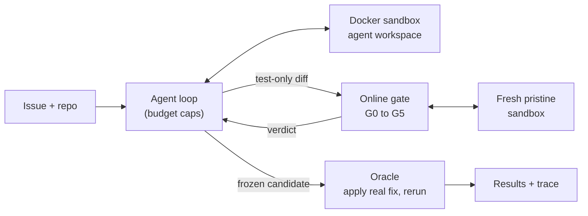

# Repro

**Bug report in, failing test out.** Repro reads a GitHub issue and a repo, and writes a test that fails on the buggy code and passes once the real fix lands.

> **Status: planning complete (2026-11-16). No code yet, so there are no results yet.**
> Everything marked `TBD` below is filled in by `repro report` at milestone M9. No number in this file is typed by hand.

## Results

<!-- RESULTS:START (generated by `repro report`, do not edit) -->

> Repro reproduces **TBD%** (95% CI TBD to TBD) of 150 real bugs from SWT-bench Verified at a median **$TBD** per bug, against **TBD%** for a single prompt with the same model. When it says "reproduced", it is right **TBD%** of the time. **TBD%** of its tests are flaky. Its tests kill **TBD%** of mutants in the fixed lines (human-written tests: **TBD%**).

| | Single prompt (B0) | Sample 5 + gate (B1) | Repro agent |
|---|---|---|---|
| Model | TBD | TBD | TBD |
| Success rate S, always-emit | TBD | TBD | TBD |
| 95% CI | TBD | TBD | TBD |
| Success rate S, gated | n/a | TBD | TBD |
| Gate precision | n/a | TBD | TBD |
| Median cost per bug | TBD | TBD | TBD |
| Cost per reproduced bug | TBD | TBD | TBD |
| Flaky rate (10x audit) | TBD | TBD | TBD |
| Mutation score (gold tests: TBD) | TBD | TBD | TBD |
| Change coverage ΔC (gold tests: 69.1) | TBD | TBD | TBD |

Agent vs single prompt, paired on the same 150 bugs: agent-only wins TBD, baseline-only wins TBD, exact McNemar p = TBD.

<!-- RESULTS:END -->

**How to read this**

- Benchmark: [SWT-bench Verified](https://swtbench.com), scored with the official harness in unit-test mode. Sample of 150 of 433 instances, fixed by a seeded script and committed before any model run: `TBD (link to pre-registration commit)`.
- Published reference points on the full 433 (swtbench.com, 2026-11-16): single prompt with GPT-4o 14.3%, OpenHands with GPT-5-mini 62.4%, Claude Code with Opus 5.5 87.8%. Repro uses a different model and a sample, is self-run, and is not a leaderboard entry. Full comparison rules are in [EVAL_AND_METRICS.md](EVAL_AND_METRICS.md#7-published-reference-points).
- These bugs and their real tests are public, so every model has probably seen some of them. The agent-vs-single-prompt gap is more trustworthy than the absolute numbers. Memorisation check: TBD.

### Where it fails

TBD at M9: table of 20 hand-read failures by cause, two or three concrete examples, and every wrong test that got past the gate.

### What it cost to build and run

TBD: total LLM spend, VM hours, wall clock for the final run.

### Demo

TBD at M10: 90-second recording. Issue text, `repro run`, the agent's steps, the test failing on the bug, the fix applied, the test passing, the cost.

## How it works



1. **Sandbox.** Every command runs in a Docker container with no network, capped memory, CPU and PIDs, and timeouts. The API key never enters it.
2. **Agent loop.** One model, six tools, hard limits on steps, dollars, wall clock, and gate checks. The budget check happens before each call, so a ceiling is never exceeded.
3. **Online gate (no fix needed).** The test must touch only test files, be collected, fail on the buggy code, fail for the right reason, fail the same way 3 times out of 3, and actually execute the code under test.
4. **Oracle (needs the fix).** Apply the real fix on a clean checkout. The test must pass 3 times out of 3.
5. **It cannot fake success.** Verification never runs in the agent's workspace. Only a diff that adds test code is carried to a clean checkout. The agent never sees the oracle's result.
6. **Quality checks.** Each emitted test is rerun 10 times to measure flakiness, and scored against small mutations of the fixed lines to see how tightly it pins the behaviour.

Full design and the reasoning behind each choice: [DESIGN.md](DESIGN.md).

## Setup

TBD as milestones land. Target shape:

```bash
git clone https://github.com/jsm05/repro && cd repro
python3 -m venv .venv && source .venv/bin/activate
pip install -e ".[dev]"
pytest -m "not docker and not live_llm"     # hermetic suite, no Docker or API key needed

repro fixtures check                         # toy bugs: fail before, pass after
repro run --repo PATH --issue ISSUE.md       # needs Docker and ANTHROPIC_API_KEY
```

Running the benchmark needs an x86_64 Linux machine with Docker and about 250 GB of disk. Steps are in [MILESTONES.md](MILESTONES.md) under E0 to E3.

## Who it is for and why

At my backend internship I write the failing test first, then the fix. Most of the time goes into the first half. Small teams without QA often skip it, so fixes ship unverified.

A chat prompt can write a test. It cannot tell you whether that test fails for the right reason, whether it is flaky, or what it cost. Repro is the harness that answers those questions.

| | |
|---|---|
| Target user | Teams of 2 to 10 engineers, Python backend, no QA function |
| Job | "When a bug report comes in, give me a failing test I can trust before I start fixing" |
| What I optimise | Being right when it speaks (it stays silent otherwise), and cost per bug |
| What it does not do | Fix bugs. Anything outside Python. Set up your environment for you. |

## Repo map

| File | What it is |
|---|---|
| [DESIGN.md](DESIGN.md) | Architecture, components, data flow, tradeoffs |
| [MILESTONES.md](MILESTONES.md) | Build plan, one session per milestone, done criteria |
| [TEST_SPEC.md](TEST_SPEC.md) | Tests that prove each milestone, including the cheat suite |
| [EVAL_AND_METRICS.md](EVAL_AND_METRICS.md) | Every headline number and exactly how it is measured |
| [RISKS.md](RISKS.md) | What can go wrong and what the plan does about it |
| `DECISIONS.md` | Log of anything that changed from the plan (starts at M1) |

## Roadmap

- [ ] M1 to M4: sandbox, gate, baselines, eval pipeline on toy bugs
- [ ] M5: agent loop
- [ ] M6 to M7: Docker, real benchmark instances, dev pilot, freeze
- [ ] M8 to M9: mutation score, flaky audit, final run
- [ ] M10: demo and write-up
- [ ] M11 (stretch): GitHub Action that comments a failing test on new issues

v2 idea: a GitHub App that does this on every new bug issue and stays silent unless the gate passes. Design notes are in [DESIGN.md](DESIGN.md#9-v2-github-app-design-only).

## Limitations

TBD in full at M10. Known from the plan: Python only; needs a prebuilt environment per repo; the gate cannot catch a test that asserts the wrong expected behaviour without the fix; benchmark contamination inflates absolute numbers; Docker is not a strong enough boundary for untrusted public repos.
