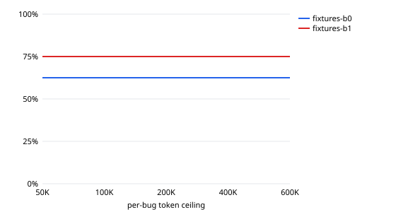

# Fixture results (cassette replay)

Generated by `repro report` from result rows only. Always-emit scores the best candidate whatever the gate said; gated emits only candidates that passed the online gate. N counts every instance: NO_TEST and INFRA_ERROR are failures.

## Success rate

| Config | Kind | Logical model | Config hash | N | Reproduced | S always-emit [95% CI] | Reproduced (gated) | S gated [95% CI] | WRONG_TEST | NO_TEST | INFRA_ERROR |
|---|---|---|---|---|---|---|---|---|---|---|---|
| `fixtures-a` | agent | fake-recorded | `e4c8e5322881d052` | 4 | 3 | 75.0% [30.1%, 95.4%] | 3 | 75.0% [30.1%, 95.4%] | 1 | 0 | 0 |
| `fixtures-b0` | B0 | fake-recorded | `fadf474d62713caf` | 8 | 5 | 62.5% [30.6%, 86.3%] | 5 | 62.5% [30.6%, 86.3%] | 2 | 1 | 0 |
| `fixtures-b1` | B1 | fake-recorded | `300043255a728278` | 4 | 3 | 75.0% [30.1%, 95.4%] | 3 | 75.0% [30.1%, 95.4%] | 1 | 0 | 0 |

## Paired comparison (always-emit, exact McNemar)

| A | B | Common instances | A only | B only | p |
|---|---|---|---|---|---|
| `fixtures-a` | `fixtures-b0` | 4 | 1 | 0 | 1.0000 |
| `fixtures-a` | `fixtures-b1` | 4 | 0 | 0 | 1.0000 |
| `fixtures-b0` | `fixtures-b1` | 4 | 0 | 1 | 1.0000 |

## Gate (gated mode)

B0 has no gate, so its gated numbers equal always-emit. Claimed = a test was emitted in gated mode.

| Config | Claimed | Precision [95% CI] | Precision without gate | Recall | Abstain rate | Gate recall cost | Rejections |
|---|---|---|---|---|---|---|---|
| `fixtures-a` | 3 | 100.0% [43.9%, 100.0%] | 75.0% | 75.0% | 25.0% | 0.0% | G0:0 G1:0 G2:1 G3:0 G4:0 G5:0 |
| `fixtures-b0` | 7 | 71.4% [35.9%, 91.8%] | 71.4% | 62.5% | 12.5% | 0.0% | G0:0 G1:0 G2:0 G3:0 G4:0 G5:0 |
| `fixtures-b1` | 3 | 100.0% [43.9%, 100.0%] | 75.0% | 75.0% | 25.0% | 0.0% | G0:0 G1:0 G2:3 G3:0 G4:0 G5:0 |

## Compute

| Config | Tokens mean | Median | p90 | Max | Total | Tokens per reproduced | Requests per bug | Rate-limit wait per bug (s) | List price per bug | List price per reproduced |
|---|---|---|---|---|---|---|---|---|---|---|
| `fixtures-a` | 5,743 | 6,118 | 6,155 | 6,155 | 22,973 | 7,658 | 3.8 | 0.0 | n/a | n/a |
| `fixtures-b0` | 394 | 380 | 455 | 455 | 3,149 | 630 | 1.0 | 0.0 | n/a | n/a |
| `fixtures-b1` | 2,014 | 2,066 | 2,188 | 2,188 | 8,057 | 2,686 | 5.0 | 0.0 | n/a | n/a |

Actual spend: $0.00 (free tiers only).

## Token ceiling curve (always-emit)

S if the per-bug token ceiling had been lower. A reproduction counts only if its candidate existed before cumulative tokens crossed the ceiling.

| Config | 50K | 100K | 200K | 400K | 600K |
|---|---|---|---|---|---|
| `fixtures-a` | 3/4 (75.0%) | 3/4 (75.0%) | 3/4 (75.0%) | 3/4 (75.0%) | 3/4 (75.0%) |
| `fixtures-b0` | 5/8 (62.5%) | 5/8 (62.5%) | 5/8 (62.5%) | 5/8 (62.5%) | 5/8 (62.5%) |
| `fixtures-b1` | 3/4 (75.0%) | 3/4 (75.0%) | 3/4 (75.0%) | 3/4 (75.0%) | 3/4 (75.0%) |

## Route mix

| Config | Route | Calls | Share |
|---|---|---|---|
| `fixtures-a` | `fake/recorded` | 15 | 100.0% |
| `fixtures-a` | retries / deferrals / mixed rows |  | 0 / 0 / 0 |
| `fixtures-b0` | `fake/recorded` | 8 | 100.0% |
| `fixtures-b0` | retries / deferrals / mixed rows |  | 0 / 0 / 0 |
| `fixtures-b1` | `fake/recorded` | 20 | 100.0% |
| `fixtures-b1` | retries / deferrals / mixed rows |  | 0 / 0 / 0 |

## Per instance

R reproduced, W wrong test, - no test, X infra error; always-emit / gated.

| Instance | `fixtures-a` | `fixtures-b0` | `fixtures-b1` |
|---|---|---|---|
| `fixture__f01_off_by_one` | R / R | R / R | R / R |
| `fixture__f02_raises` | R / R | R / R | R / R |
| `fixture__f03_wrong_reason_trap` | W / - | W / W | W / - |
| `fixture__f04_hash_order` |  | R / R |  |
| `fixture__f05_append_only` |  | R / R |  |
| `fixture__f06_two_modules` | R / R | - / - | R / R |
| `fixture__f07_ambiguous_issue` |  | R / R |  |
| `fixture__f08_can_hang` |  | W / W |  |
