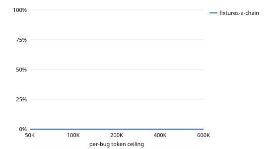

# Agent on the fixtures, live free-tier models (A-chain, dev only)

Generated by `repro report` from result rows only. Always-emit scores the best candidate whatever the gate said; gated emits only candidates that passed the online gate. N counts every instance: NO_TEST and INFRA_ERROR are failures.

## Success rate

| Config | Kind | Logical model | Config hash | N | Reproduced | S always-emit [95% CI] | Reproduced (gated) | S gated [95% CI] | WRONG_TEST | NO_TEST | INFRA_ERROR |
|---|---|---|---|---|---|---|---|---|---|---|---|
| `fixtures-a-chain` | agent | dev | `989c1f05c5175276` | 8 | 0 | 0.0% [0.0%, 32.4%] | 0 | 0.0% [0.0%, 32.4%] | 0 | 0 | 8 |

## Gate (gated mode)

B0 has no gate, so its gated numbers equal always-emit. Claimed = a test was emitted in gated mode.

| Config | Claimed | Precision [95% CI] | Precision without gate | Recall | Abstain rate | Gate recall cost | Rejections |
|---|---|---|---|---|---|---|---|
| `fixtures-a-chain` | 0 | n/a n/a | n/a | 0.0% | 0.0% | 0.0% | G0:0 G1:0 G2:0 G3:0 G4:0 G5:0 |

## Compute

| Config | Tokens mean | Median | p90 | Max | Total | Tokens per reproduced | Requests per bug | Rate-limit wait per bug (s) | List price per bug | List price per reproduced |
|---|---|---|---|---|---|---|---|---|---|---|
| `fixtures-a-chain` | 0 | 0 | 0 | 0 | 0 | n/a | 0.0 | 0.0 | n/a | n/a |

Actual spend: $0.00 (free tiers only).

## Token ceiling curve (always-emit)

S if the per-bug token ceiling had been lower. A reproduction counts only if its candidate existed before cumulative tokens crossed the ceiling.

| Config | 50K | 100K | 200K | 400K | 600K |
|---|---|---|---|---|---|
| `fixtures-a-chain` | 0/8 (0.0%) | 0/8 (0.0%) | 0/8 (0.0%) | 0/8 (0.0%) | 0/8 (0.0%) |

## Route mix

| Config | Route | Calls | Share |
|---|---|---|---|
| `fixtures-a-chain` | retries / deferrals / mixed rows |  | 0 / 0 / 0 |

## Per instance

R reproduced, W wrong test, - no test, X infra error; always-emit / gated.

| Instance | `fixtures-a-chain` |
|---|---|
| `fixture__f01_off_by_one` | X / X |
| `fixture__f02_raises` | X / X |
| `fixture__f03_wrong_reason_trap` | X / X |
| `fixture__f04_hash_order` | X / X |
| `fixture__f05_append_only` | X / X |
| `fixture__f06_two_modules` | X / X |
| `fixture__f07_ambiguous_issue` | X / X |
| `fixture__f08_can_hang` | X / X |
